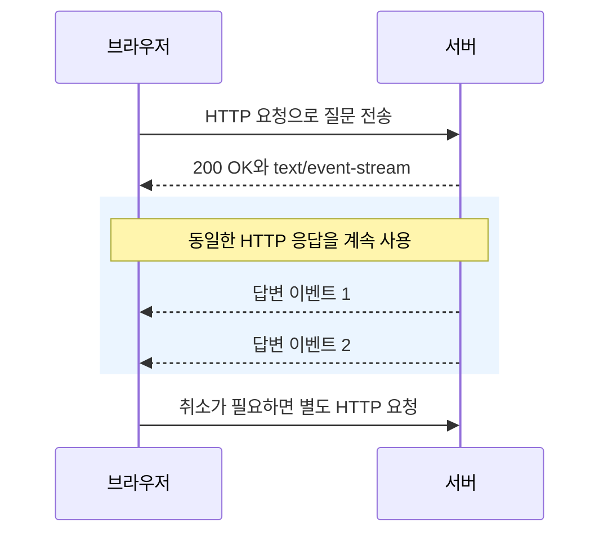
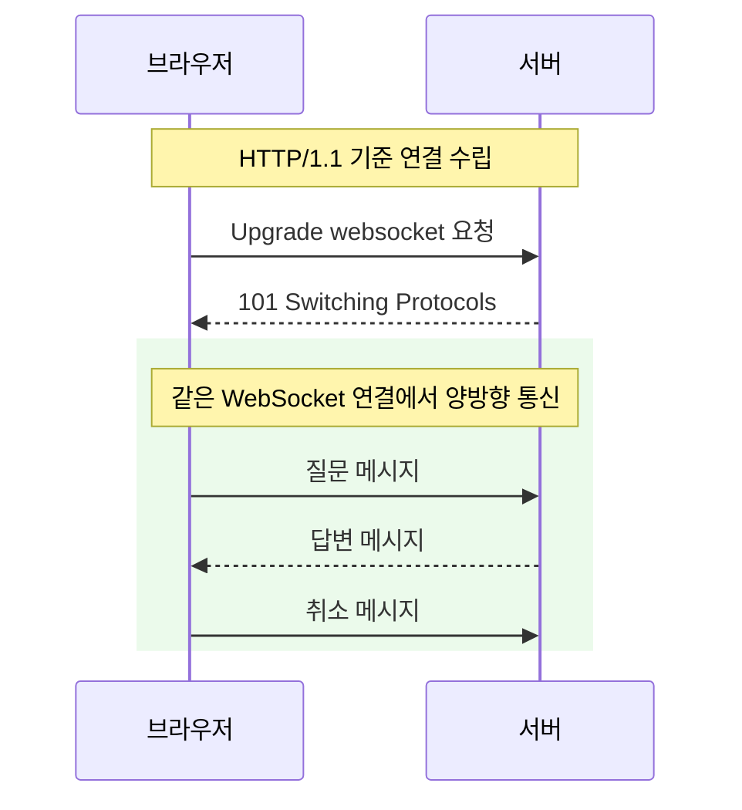

# SSE와 WebSocket 및 STOMP의 역할

> SSE는 HTTP 응답으로 서버 이벤트를 전달하고, WebSocket은 양방향 메시지를 교환하며, STOMP는 메시지의 명령·구독·목적지를 정의한다.

- **방향:** SSE 스트림은 서버에서 클라이언트로 흐르고, WebSocket 연결에서는 양쪽이 메시지를 전송한다.
- **메시징:** STOMP의 SEND·SUBSCRIBE·MESSAGE로 전송과 수신 규칙을 표현한다.
- **경계:** 이들 프로토콜만으로 채팅 기록 저장·오프라인 복구·읽음 처리가 완성되지는 않는다.

<details>
<summary>설명과 예제 펼치기</summary>

## 설명

SSE는 `text/event-stream` HTTP 응답을 열어 두고 그 본문에 이벤트를 계속 쓴다. 클라이언트는 UTF-8 텍스트를 파싱하고 빈 줄을 만나 이벤트를 전달한다. 같은 응답에서 클라이언트가 명령을 보내지는 않지만, 질문·취소를 별도 HTTP 요청으로 보낼 수 있다. 따라서 질문을 입력하는 AI 채팅도 SSE로 구현할 수 있다.

WebSocket은 연결을 유지하며 텍스트·바이너리 메시지를 교환한다. HTTP/1.1 환경에서는 HTTP Upgrade 핸드셰이크로 시작하며, `wss://`는 TLS로 보호되는 연결이다. WebSocket 자체가 채팅방·참여 권한·DB 저장을 정의하지는 않는다.

| 항목 | SSE | WebSocket |
| --- | --- | --- |
| 통신 흐름 | 하나의 HTTP 응답에 이벤트를 계속 추가 | 연결 수립 후 양쪽이 메시지를 전송 |
| 같은 통로의 방향 | 서버 → 클라이언트 | 서버 ↔ 클라이언트 |
| 데이터 | UTF-8 텍스트에 JSON 등을 포함 | 텍스트·바이너리 |
| 브라우저 재연결 | EventSource가 자동 재연결 지원 | 애플리케이션에서 구현 |
| 적용 예 | AI 답변·알림·작업 진행률 | 게임 상태·공동 편집·빈번한 양방향 메시지 |

### SSE 흐름



### WebSocket 흐름



STOMP는 WebSocket 위에서 사용할 수 있는 메시징 프로토콜이다. 명령, 헤더, 본문으로 구성된 프레임을 사용한다. STOMP 없이 WebSocket에 JSON을 보내는 설계도 가능하지만 메시지 종류와 라우팅 규칙을 직접 정해야 한다. STOMP는 WebSocket 전용이 아니며 TCP 위에서도 사용할 수 있다.

## 프레임 예제

STOMP 1.2의 형태를 보여 주는 예시다. `<NUL>`은 실제 전송 시 프레임 끝을 나타내는 널 바이트다.

```text
SUBSCRIBE
id:chat-subscription
destination:/user/queue/messages

<NUL>

SEND
destination:/pub/rooms/42/messages
content-type:application/json

{"content":"안녕하세요"}
<NUL>
```

| 명령 | 역할 |
| --- | --- |
| CONNECT / CONNECTED | STOMP 연결 협상 |
| SEND | 목적지로 메시지 전송 |
| SUBSCRIBE / UNSUBSCRIBE | 구독 시작·해제 |
| MESSAGE | 구독한 클라이언트에 메시지 전달 |
| ACK / NACK | 수신 메시지의 처리 확인·부정 확인 |
| RECEIPT | 요청한 프레임의 서버 처리 확인 |

## 주의점

EventSource의 자동 재연결이 누락 이벤트를 자동 복구하지는 않는다. 이벤트 ID와 `Last-Event-ID`를 이용해 어디서 재개할지 정하고 서버가 재전송을 구현해야 한다. 답변 전송 단위는 [SSE의 조각 묶기](../../spring/mvc/sse-stream-buffering.md)처럼 애플리케이션이 정한다.

그림의 Upgrade·101 과정은 HTTP/1.1 기준이다. HTTP/2의 WebSocket 연결은 [RFC 8441](https://www.rfc-editor.org/rfc/rfc8441.html)의 Extended CONNECT 방식이므로 모든 HTTP 버전에 같은 핸드셰이크를 일반화하지 않는다.

STOMP는 `destination` 헤더를 정의하지만 목적지 문자열의 문법·의미는 서버에 맡긴다. `/topic`과 `/queue`는 모든 STOMP 서버가 동일하게 처리해야 하는 표준 키워드가 아니다.

프로토콜이 ACK를 정의해도 사용 중인 브로커가 지원하는지 확인해야 한다. RECEIPT나 TCP 전달 성공은 DB 커밋·상대방의 읽음을 자동으로 증명하지 않는다. Spring에서의 실제 라우팅은 [Spring STOMP 메시지 라우팅](../../spring/mvc/stomp-message-routing.md)을 참고한다.

## 꼬리질문

1. SSE에서 서버가 보내는 이벤트마다 새로운 HTTP 응답이 생기는가? WebSocket의 메시지 전송과는 어떤 차이가 있는가?
2. `/ws`에 연결한 클라이언트가 `/pub/rooms/42/messages`로 보낼 때 새 HTTP 연결이 필요한가? STOMP 같은 메시징 규칙은 이 과정에 무엇을 더하는가?
3. 연결이 끊긴 동안의 메시지와 읽음 상태를 복구하려면 프로토콜 밖에서 무엇을 설계해야 하는가?

</details>

## 참고 자료

- [WHATWG SSE 표준](https://html.spec.whatwg.org/multipage/server-sent-events.html) — HTTP 응답의 이벤트 파싱·인코딩·재연결 규칙을 확인한다.
- [RFC 6455 The WebSocket Protocol](https://datatracker.ietf.org/doc/html/rfc6455) — 핸드셰이크·프레임·서브프로토콜의 책임을 확인한다.
- [STOMP 1.2 Specification](https://stomp.github.io/stomp-specification-1.2.html) — 명령·목적지·ACK·RECEIPT의 정확한 의미를 읽는다.
