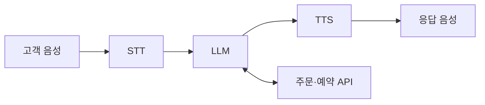

# AI 전화 상담의 음성 파이프라인: STT·TTS와 speech-to-speech

> 전화 상담은 통화 음성을 서버로 연결한 뒤 STT → LLM → TTS로 처리하거나, 음성을 직접 이해하고 응답하는 speech-to-speech 방식으로 구성한다.

- **연결:** 전화 연동 서비스가 전화망의 통화와 인터넷 음성 스트림을 연결한다.
- **처리:** Chained voice pipeline은 음성 인식·답변 생성·음성 합성을 별도 단계로 조합한다.
- **구분:** Speech-to-speech는 음성을 직접 입력·출력하며, 별도 STT·TTS 연결을 필수로 요구하지 않는다.

설명과 주의점 펼치기

## 설명

학습 질문: “전화를 AI 서버로 연결해서 STT를하고 AI에게 질문하고 대답을 얻으면 TTS로 변환해서 다시 통화로 이어지나?”

맞다. 이 구성이 **chained voice pipeline**이다. 다만 전화번호로 건 통화가 서버의 HTTP 주소로 바로 연결되는 것은 아니다. 전화 연동 서비스나 교환기가 통화를 받아 서버에 음성을 전달하고, 서버가 보낸 응답 음성을 같은 통화에서 재생한다. Twilio의 양방향 Media Streams는 이 구간에 WebSocket을 사용한다.

| 단계 | 뜻 | 배송 문의에서 하는 일 |
| --- | --- | --- |
| STT: Speech-to-Text | 음성 인식·전사 | 고객 음성을 “언제 배송되나요?”라는 텍스트로 변환 |
| LLM: Large Language Model | 질문 해석·답변 생성 | 주문 조회 API 결과를 받아 답변 문장 생성 |
| TTS: Text-to-Speech | 음성 합성 | “내일 도착 예정입니다”를 음성으로 변환 |

Chained는 이 세 단계를 이어 붙였다는 뜻이다. 각 서비스를 교체하거나 중간 텍스트를 확인·수정하기 쉽다. 아래는 특정 제품의 내부 구현이 아닌 개념 흐름이다.

**Speech-to-speech**는 실시간 음성 모델에 고객 음성을 보내고 응답 음성을 받는 방식이다. 애플리케이션이 중간 전사문을 LLM에 넘기고 답변을 다시 TTS에 보내는 단계를 반드시 구성할 필요는 없다. 기록용 전사문이나 업무 API 호출은 함께 사용할 수 있다.

전화 연결 방식과 AI 처리 방식은 따로 선택한다. [SIP](sip.md)는 통화 설정·종료를, [RTP](rtp.md)·[SRTP](srtp.md)는 미디어 전송을 다룬다. 이 프로토콜을 선택했다고 STT나 TTS가 자동으로 수행되는 것은 아니다.

## 주의점

- Chained 방식도 서비스가 지원하면 입력 음성·생성 텍스트·출력 음성을 스트리밍할 수 있다. 전체 통화를 녹음한 뒤 처리해야 한다는 뜻은 아니다.
- 응답 지연에는 발화 종료 판단, 모델 처리, 네트워크, 재생 버퍼가 모두 영향을 준다. Speech-to-speech도 무지연을 보장하지 않는다.
- 고객이 끼어들면 응답 생성뿐 아니라 이미 쌓인 재생 음성도 중단해야 한다. 모델이 말했지만 고객이 듣지 못한 부분은 대화 상태에서도 구분한다.
- 전화 연동 서비스가 요구하는 코덱·샘플레이트에 맞춰 음성을 보내야 한다. 예를 들어 Twilio Media Streams의 반환 음성은 μ-law, 8 kHz 형식을 요구한다.

## 꼬리질문

1. STT와 TTS는 각각 무엇을 입력받고 출력하며, chained pipeline의 중간 텍스트를 확인할 수 있다는 것은 어떤 장점인가?
2. 고객의 배송 문의를 듣고 주문 API를 조회한 뒤 전화로 답하려면, 전화 연동 서비스와 통화 서버가 어떤 데이터를 주고받아야 하는가?
3. 고객이 AI 답변 도중 다른 주문을 묻는다면, 생성 취소만으로 충분한가? 재생 버퍼와 대화 기록은 어떻게 처리해야 하는가?

## 참고 자료

- [OpenAI — Voice agents](https://developers.openai.com/api/docs/guides/voice-agents) — STT·에이전트·TTS를 연결하는 chained 구조와 speech-to-speech 구조를 비교한다.
- [OpenAI — Realtime conversations](https://developers.openai.com/api/docs/guides/realtime-conversations) — 직접 음성 입출력, 업무 도구 호출, 끼어들기와 미재생 음성 처리 원리를 확인한다.
- [Twilio — Media Streams WebSocket Messages](https://www.twilio.com/docs/voice/media-streams/websocket-messages) — 전화 음성을 WebSocket으로 주고받는 방법과 반환 오디오 형식·버퍼 제어를 확인한다.
