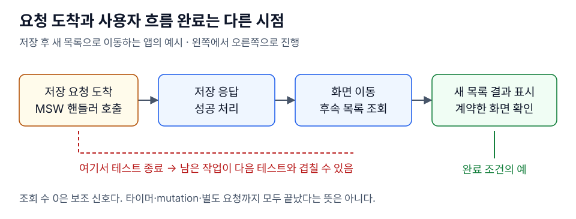

# 비동기 UI 테스트의 완료 조건

> 요청이 핸들러에 도착한 시점과 사용자 흐름의 완료를 구분하고, 이번 동작으로 바뀐 화면을 확인한 뒤 테스트를 끝낸다.

- **경계:** 저장 응답 뒤 이동·목록 재조회가 이어질 수 있다.
- **조회:** 같은 문구의 이전 요소가 있으면 `findBy`도 즉시 성공할 수 있다.
- **증거:** 새 화면과 데이터가 준비됐는지 확인하고 진행 중 조회 수는 보조 신호로 사용한다.

<details>
<summary>설명·그림과 테스트 예제·꼬리질문 펼치기</summary>

## 설명

MSW 핸들러가 호출됐다는 사실은 요청이 도착했다는 증거다. 응답 처리, 성공 콜백, 라우팅, 새 화면의 조회까지 끝났다는 뜻은 아니다. 앞 테스트가 이 지점에서 끝나면 늦게 시작된 목록 요청이 다음 테스트의 요청 기록을 늘릴 수 있다.

테스트의 완료 조건을 먼저 정한다. 저장 후 목록으로 이동하는 시나리오라면 새 경로와 목록 결과까지 확인한다. 반대로 저장 자체만 검증하는 테스트라면 화면 이동을 포함한 통합 흐름과 책임을 나누고, 남는 작업은 [수명에 맞게 취소·정리](query-cancellation-and-lifecycle.md)한다.

## 그림으로 보기



## 테스트 예제

React Testing Library·user-event·jest-dom·Vitest를 사용한다. 화면·메모리 라우터·해당 화면의 QueryClient가 준비된 테스트의 단언 부분이다. 저장 후 `/library`로 이동하고 새 목록에 `수정한 항목`이 보이는 계약을 가정한다.

```tsx
// 각 테스트에서 새로 준비한 user, router, queryClient를 사용한다.
expect(screen.queryByText('저장했어요')).not.toBeInTheDocument();
await user.click(screen.getByRole('button', { name: '저장' }));

expect(await screen.findByText('저장했어요')).toBeInTheDocument();
await waitFor(() => {
  expect(router.state.location.pathname).toBe('/library');
});
expect(await screen.findByText('수정한 항목')).toBeInTheDocument();
await waitFor(() => {
  expect(queryClient.isFetching({ queryKey: ['purchased'] })).toBe(0);
});
```

`waitFor` 콜백은 여러 번 실행될 수 있으므로 클릭·상태 변경을 넣지 않고 단언한다. 거짓을 반환하는 것만으로는 재시도되지 않으므로 `expect`가 실패하도록 쓴다.

## 주의점

`findBy`는 조건에 맞는 요소가 **존재하는지** 기다린다. 이번 클릭 때문에 생긴 요소인지는 모른다. [스토어를 초기화](global-store-and-timer-isolation.md)하고 이번 작업의 결과를 식별해야 한다. React가 요소를 교체했을 가능성이 있으면 변경 뒤 `screen`으로 다시 조회한다. 새 요소를 찾는 것만으로 이전 상태 누수가 해결되지는 않는다.

`isFetching() === 0`은 해당 QueryClient에서 추적하는 조회의 순간 상태다. 이후 타이머가 시작할 요청, mutation, WebSocket, 별도 `fetch`의 완료를 증명하지 않는다. 임의의 `sleep`을 늘리거나 실제 중복 요청을 허용하도록 기대 횟수를 바꾸기 전에 어떤 테스트·동작에서 요청을 만들었는지 조사한다.

## 꼬리질문

1. 저장 요청이 MSW 핸들러에 도착한 뒤에도 어떤 UI·네트워크 작업이 남아 있을 수 있는가?
2. 이전 토스트와 새 토스트의 문구가 같을 때 `findByText`의 성공이 잘못된 증거가 되는 이유는 무엇인가?
3. 조회 수가 0이어도 다음 테스트에 요청이 도착한다면 추적되지 않는 작업과 지연된 작업을 어떻게 구분할까?

</details>

## 참고 자료

- [Testing Library · Async Methods](https://testing-library.com/docs/dom-testing-library/api-async/) — `findBy`와 `waitFor`의 재시도 조건을 확인한다.
- [TanStack Query · QueryClient.isFetching](https://tanstack.com/query/latest/docs/reference/QueryClient#queryclientisfetching) — 조회 수의 의미와 필터 범위를 확인한다.
- [React · Preserving and Resetting State](https://react.dev/learn/preserving-and-resetting-state#option-2-resetting-state-with-a-key) — `key` 변경이 컴포넌트를 새로 만드는 이유를 읽는다.
