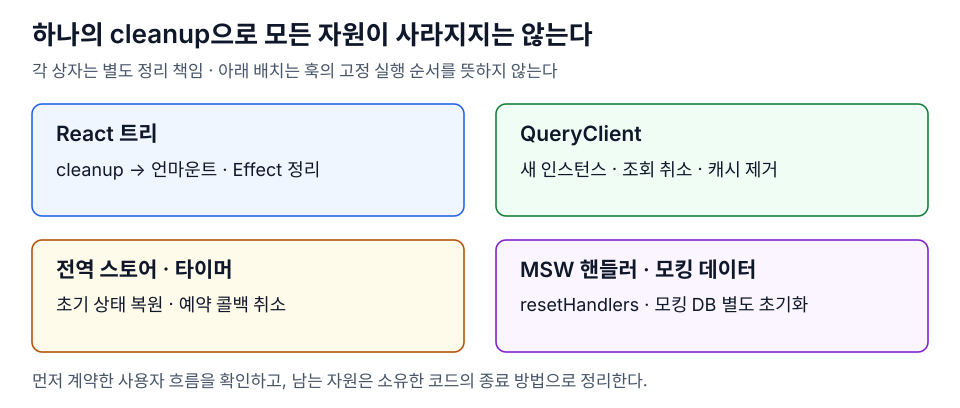

# MSW 핸들러와 테스트 자원의 격리

> MSW 핸들러 초기화와 앱 자원 정리를 구분하고 테스트가 만든 DOM·쿼리·스토어·모킹 데이터를 각 수명에 맞게 종료한다.

- **모킹:** `resetHandlers()`는 런타임에 추가한 핸들러를 복원한다.
- **자원:** 테스트마다 별도 QueryClient를 준비하고 남은 작업을 정리한다.
- **관측:** 요청 횟수 이상은 이전 테스트 누수뿐 아니라 현재 앱의 재조회에서도 생길 수 있다.

<details>
<summary>설명·그림과 TypeScript 예제·꼬리질문 펼치기</summary>

## 설명

MSW는 앱이 보내는 요청에 모의 응답을 제공한다. 핸들러를 초기화해도 앱의 타이머, 이미 시작된 요청, 핸들러 밖 배열로 만든 모킹 DB까지 복구되지는 않는다. 다음 테스트가 새 핸들러를 등록했는데 이전 테스트의 늦은 요청이 도착하면, 새 기록에 남의 요청이 더해질 수 있다.

| 자원 | 테스트 경계에서 할 일 |
| --- | --- |
| React 트리 | `cleanup()`으로 언마운트하고 Effect의 정리를 실행 |
| QueryClient | 테스트마다 생성, 추적 중인 조회 취소·캐시 제거 |
| 모듈 전역 상태·타이머 | 해당 모듈의 reset·dispose 호출 |
| MSW 런타임 핸들러 | `server.resetHandlers()` |
| 모킹 DB·요청 기록 | 기본 데이터의 새 복사본 생성·배열 초기화 |
| 저장소·URL·소켓·구독 | 테스트가 변경·생성한 자원에 맞게 복원·해제 |

## 그림으로 보기



## TypeScript 예제

Vitest·MSW 2·Testing Library를 사용하는 파일의 생명주기 예시다. 실제 render helper는 여기서 생성한 `queryClient`를 `QueryClientProvider`에 전달해야 한다. `resetToast`는 [스토어 초기화 예제](global-store-and-timer-isolation.md)의 함수다.

```ts
import { act, cleanup } from '@testing-library/react';
import { QueryClient } from '@tanstack/react-query';
import { setupServer } from 'msw/node';
import { afterAll, afterEach, beforeAll, beforeEach } from 'vitest';
import { resetToast } from '../toast-store';

const server = setupServer(); // 기본 핸들러가 있다면 인자로 전달한다.
let queryClient: QueryClient;

beforeAll(() => server.listen({ onUnhandledRequest: 'error' }));
beforeEach(() => {
  queryClient = new QueryClient({
    defaultOptions: { queries: { retry: false } },
  });
});
afterEach(async () => {
  cleanup();
  await queryClient.cancelQueries();
  queryClient.clear();
  act(() => resetToast());
  server.resetHandlers();
});
afterAll(() => server.close());
```

이 순서는 이 예제의 자원 관계를 위한 것이다. 별도 소켓·mutation·모킹 DB가 있으면 해당 종료 절차를 추가한다. 누락된 `signal` 전달이나 끝나지 않은 콜백을 이 훅만으로 해결했다고 간주하지 않는다.

## 주의점

기본 `retry: false`는 재시도 자체를 검증하지 않는 테스트를 단순하게 한다. 개별 쿼리의 명시적 설정이 우선하며, 재시도 기능을 검증할 때는 그 계약을 따로 테스트한다. 공유 MSW·스토어를 서로 다르게 바꾸는 테스트는 `concurrent`로 돌리지 않거나 실행 컨텍스트를 분리한다.

요청 횟수가 늘었다면 선행 테스트의 누수 외에도 현재 화면의 invalidate·재마운트·포커스·재연결·재시도를 조사한다. 모킹 서버의 기록만으로 어느 QueryClient가 요청했는지 알 수는 없다. [실행 순서와 쿼리 이벤트](test-order-and-reproducibility.md)를 함께 관측해 가설을 좁힌다.

## 꼬리질문

1. `server.resetHandlers()`를 호출했는데도 요청 기록이 다음 테스트에서 늘어나는 이유는 무엇일 수 있는가?
2. QueryClient를 매 테스트마다 새로 만들었는데 모킹 DB 배열을 공유하면 어떤 순서 의존이 남는가?
3. 같은 서버 핸들러를 바꾸는 두 테스트를 동시에 실행하려면 어떤 자원을 더 분리해야 하는가?

</details>

## 참고 자료

- [MSW · resetHandlers](https://mswjs.io/api/setup-server/reset-handlers) — 런타임 핸들러 복원과 기본 핸들러 교체의 차이를 확인한다.
- [MSW · Node.js integration](https://mswjs.io/guides/integrations/node) — 모킹 서버의 시작·테스트 후 복원·종료 흐름을 확인한다.
- [TanStack Query · Testing](https://tanstack.com/query/latest/docs/framework/react/guides/testing) — QueryClient 격리와 테스트용 재시도 설정을 읽는다.
